<p align="center">
  
</p>

<p align="center">
  <a href="mailto:nguyen.ld2310@gmail.com"></a>
  <a href="https://www.linkedin.com/in/nguyên-lê-0752b3233"></a>
  <a href="https://andrewhaward2310.github.io/gnn-il-ppo-paper/"></a>
</p>

```yaml
engineer:
  role:     AI Engineer · Humanoid Robotics
  focus:    [reinforcement-learning, imitation-learning, sim-to-real, whole-body-control]
  stack:    [python, c++, pytorch, ros2, isaac-sim, mujoco]
  base:     Hanoi, Vietnam
  edu:      B.Eng. Mechatronics @ HUST
```

<p align="center">
  
</p>
